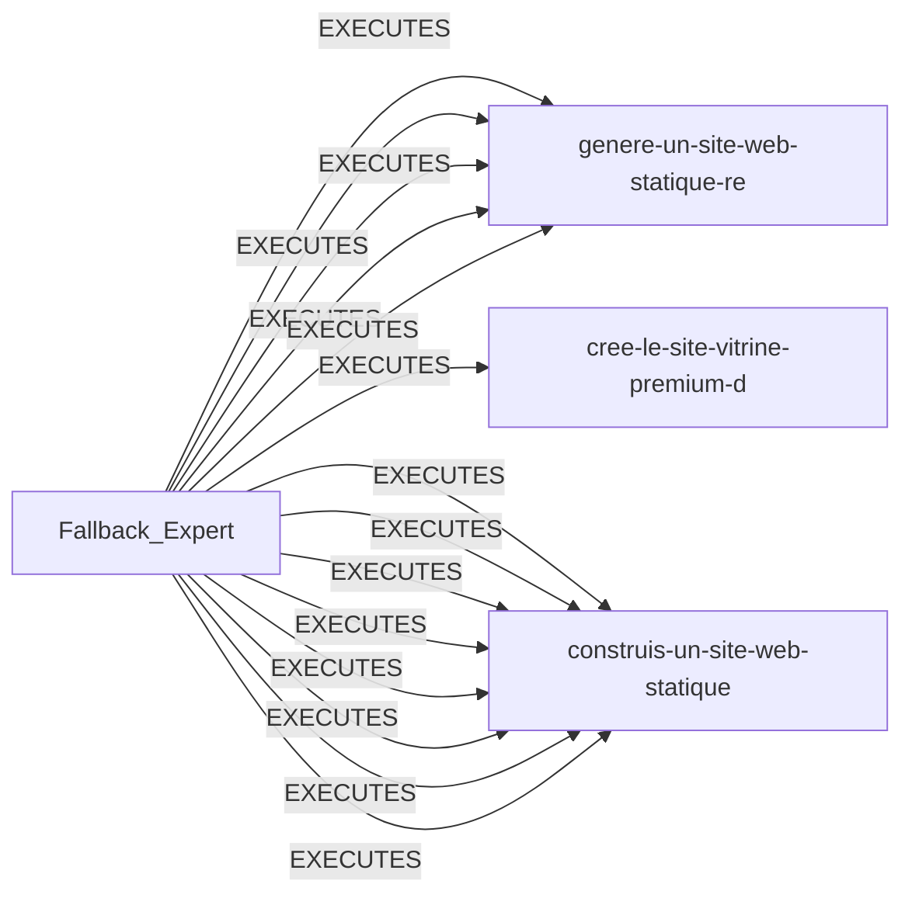

# Agent: Fallback_Expert

| Propriété | Valeur |
|-----------|--------|
| Niveau | L1 |
| Rôle | frontend |
| Success Rate | 8.0% |
| Projets exécutés | 14 |
| Qualité moyenne | 0.8/10 |

## Prompt Preview
```
Tu es un expert par défaut. Résous la tâche.
```

## Relations
- 🤖 [[Fallback_Expert]] — 
- 📁 [[construis-un-site-web-statique-pour-le-cafe-bastoc-c1]] — 
- 📁 [[construis-un-site-web-statique-complet-et-unique-e-c1]] — 
- 🤖 [[Senior_Static_Site_Forge_Engineer]] — 
- 📁 [[cree-le-site-vitrine-premium-du-cafe-bastoche--ixe-c1]] — 
- 📁 [[construis-un-site-web-statique-complet-pour-le-caf-c1]] — 
- 📁 [[genere-un-site-web-statique-responsive-design-ultr-c1]] — 

## Graphe


---
*Auto-généré par Knowledge Curator*
