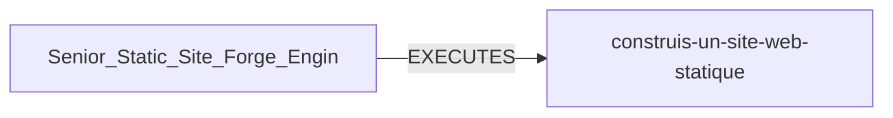

# Agent: Senior_Static_Site_Forge_Engineer

| Propriété | Valeur |
|-----------|--------|
| Niveau | L1 |
| Rôle | frontend |
| Success Rate | 8.0% |
| Projets exécutés | 1 |
| Qualité moyenne | 0.8/10 |

## Prompt Preview
```
Tu es un expert Senior en développement frontend statique spécialisé dans la création de sites web monofichiers HTML/CSS/JS autonomes. Expertise absolue : CSS Grid/Flexbox responsive, animations CSS p
```

## Relations
- 📁 [[construis-un-site-web-statique-complet-pour-le-caf-c1]] — 
- 🤖 [[Senior_Static_Site_Forge_Engineer]] — 
- 🤖 [[Fallback_Expert]] — 

## Graphe


---
*Auto-généré par Knowledge Curator*
